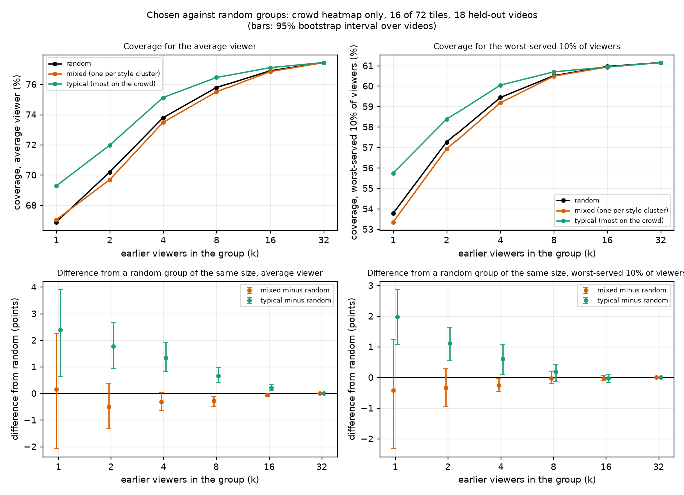
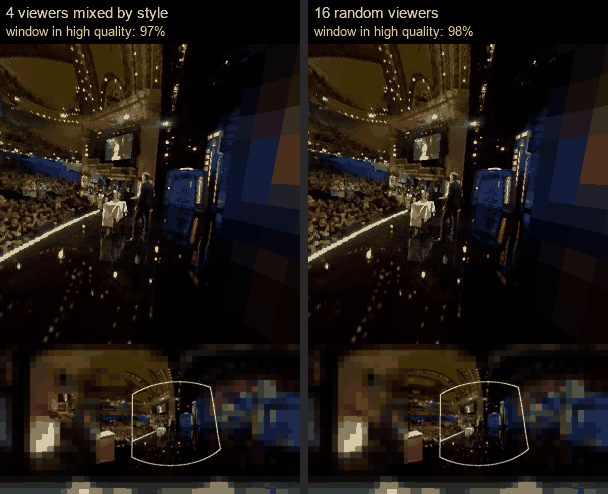

# Whose eyes should a VR stream learn from?

A test of whether a small, deliberately mixed group of earlier viewers predicts where the next viewer of a 360° video will look better than a random group of the same size.

<!-- MYO: write 2–4 sentences on why you cared -->

## What I found

It does not. A group of 4 viewers mixed by viewing style did no better than 4 random viewers, and 16 random viewers beat every group of 4 I could choose. The one choice that helped a little was the opposite of variety: picking the most typical viewers.



## Background

A headset shows a window about 100 degrees wide out of the whole sphere. A streaming system cuts the picture into tiles and sends in high quality only the tiles it expects you to look at, often by copying earlier viewers. A new or live video has only a few earlier viewers, so I asked whether it matters who they are.

## The two explanations

- **Quantity.** Only the number of earlier viewers matters. Who they are averages out.
- **Diversity.** People watch in different styles. A random group over-represents the common style and fails the rest, so a small mixed group should do better, above all for the worst-served viewers.

Quantity held. Composition matters a little when the group is very small, and then it favours conformists. I think the diversity idea fails for a simple reason: a style says how a person watches, and the stream needs to know where.

## How I tested it

- **Data.** Wu, Tan, Wang and Yang's head-tracking dataset (MMSys 2017): 48 viewers, 18 videos. I first checked that a viewer number means the same person across videos ([note](results/id_linkage.md)).
- **Tiles and budget.** The frame is cut into 6 x 12 tiles, 72 in all. The system may send 16 in high quality. That is the smallest budget at which perfect foresight covers at least 95% of the window ([note](results/budget.md)).
- **Held-out videos.** Each video is the test video in turn. A viewer's style is measured on the other 17 videos only.
- **Trials.** In each of 200 trials per video, 16 viewers are set aside as test viewers and groups are picked from the other 32.
- **Three ways to pick a group.** Random. Mixed: cluster the pool by style and take one viewer from each cluster. Typical: the viewers who stay closest to the crowd, added as a control.
- **Score.** Coverage is the share of a test viewer's window that lands on high-quality tiles. I report the average viewer and the worst-served 10% of viewers.
- **Uncertainty.** Every interval is a 95% bootstrap over the 18 videos, on differences paired by video.

Coverage in percent, and differences in points with intervals:

| Group | Average viewer | Worst-served 10% | Against 4 random | Against 16 random |
|---|---|---|---|---|
| 4 random | 73.8 | 59.4 | | -3.1 (-3.7 to -2.5) |
| 4 mixed by style | 73.5 | 59.2 | -0.3 (-0.6 to +0.0) | -3.4 (-4.0 to -2.8) |
| 4 typical | 75.1 | 60.0 | +1.3 (+0.8 to +1.9) | -1.8 (-2.3 to -1.3) |
| 16 random | 76.9 | 61.0 | | |

For the worst-served 10%, the mixed group scores -0.3 points against 4 random viewers (-0.5 to -0.0) and the typical group +0.6 (+0.1 to +1.1). Read off the random curve, 4 mixed viewers are worth 3.8 random viewers and 4 typical viewers are worth 6.4. The full tables are in [chosen_vs_random.md](results/chosen_vs_random.md) and [four_vs_sixteen.md](results/four_vs_sixteen.md).

It helps to know how much a crowd is worth at all ([baselines](results/baselines.md)). Assuming the viewer keeps looking where they look now covers 86.8% of the window 1 second ahead and 74.9% at 5 seconds. A random crowd covers 66.9% with 1 viewer and 77.4% with 32. So a crowd only beats the viewer's own motion at 5 seconds, and blending the two reaches 79.8% there. With that blend, every difference between groups is under one point. The crowd question only matters for long look-ahead.

## Demo



One viewer's real head motion over 10 seconds. On the left the 16 tiles come from 4 viewers mixed by style, on the right from 16 random viewers. Other tiles are drawn blocky. In this clip the two crowds cover 59% and 90% of the window. Over the whole video they cover 75% and 80% for this viewer. I picked the seconds where this viewer's gap was largest, so the clip shows the mechanism and the table above is the evidence ([details](results/demo.md)).

## What surprised me

- **Style is real and still useless here.** I expected the hard part to be whether style is a stable trait. It is: head speed correlates 0.88 between two halves of the videos and 0.51 across the two experiments ([check](results/style_check.md)). The result failed one step later.
- **Active viewers do not predict active viewers.** A group of four active viewers covers 71.6% of an active viewer's window. Four calm viewers cover 72.2%. Two explorers do not explore the same place ([check](results/why_not_mixed.md)).
- **A bigger budget does not rescue it.** I thought 16 tiles left no room to serve a second camp. With 24 tiles the mixed group still scores -0.2 points against random.

## What went wrong along the way

- My first design scored everyone who was not in the group. A method that puts unusual viewers in the group then removes them from the test and looks better for free. Setting test viewers aside first fixed it.
- I read the paper's description of the frame the wrong way round. Drawing viewers' gaze on a real frame showed it ([picture](results/frame_orientation.jpg)). Only drawings changed, because a mirrored tile grid is the same grid.

The rest is in [CHANGELOG.md](CHANGELOG.md). Catching my own mistakes with small tests was the most useful habit in this project.

## Limits

- 48 viewers from one lab and 18 videos. The intervals treat videos as the unit and say nothing about other kinds of viewer.
- The paper does not state outright that viewer numbers match across its two experiments. The recordings support it. Using style from the same experiment only gives the same answer: -0.7 for mixed and +1.4 for typical at 4 viewers.
- Style here is three simple numbers. A richer notion, such as what kind of content a person follows, might find real camps.

## What I would do next

Test the typical-viewer result where it would be used: a live broadcast in which a few viewers watch slightly ahead of everyone else. The related work is in [docs/related_work.md](docs/related_work.md). I would rather try that on a larger dataset first, because 48 people is thin for a claim about people.

## Run it

```
pip install -r requirements.txt
python -m scripts.download
python -m scripts.check_ids
python -m scripts.heatmaps
python -m scripts.baselines
python -m scripts.chosen_vs_random
python -m scripts.four_vs_sixteen
python -m scripts.why_not_mixed
python -m scripts.check_readme
python -m pytest -q
```

A shorter run with fewer trials is in the [Colab notebook](https://colab.research.google.com/github/FireCloud24/vr-whose-eyes/blob/main/notebooks/vr_whose_eyes.ipynb). The demo also needs one video file and ffmpeg ([script](scripts/demo.py)).

Data: Wu, Tan, Wang and Yang, "A Dataset for Exploring User Behaviors in VR Spherical Video Streaming", MMSys 2017, from the authors' [page](https://wuchlei-thu.github.io). The data is downloaded by the script and is not in this repo.
